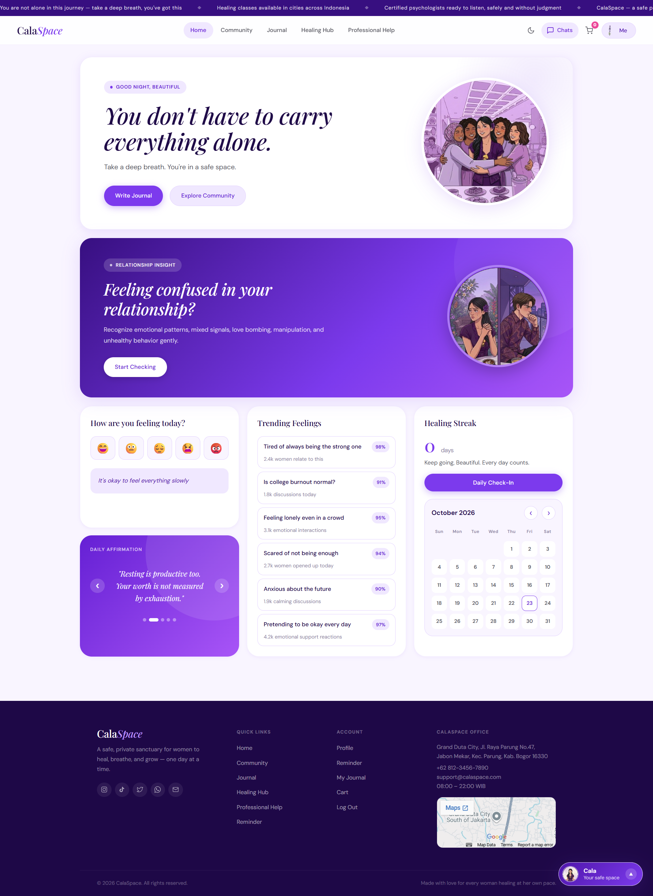

 

  

*A personal web project exploring women's mental wellness, self-care, and a little space to pause.*

 

  

୨୧ &nbsp; slow down, check in, and make space for yourself &nbsp; ୨୧

---

## ୨୧ About the Project

**CalaSpace** is a personal web project centered around women's mental wellness and self-care.

The idea is to create a calm, approachable digital space where users can explore wellness-related activities and interact with features such as journaling. The project combines a soft visual direction with simple web interactions to explore how design and functionality can work together to create a more thoughtful user experience.

## ୨୧ Project Goals

- Explore a welcoming and user-friendly wellness website experience.
- Create an interface with a consistent visual style and clear layout.
- Add interactive elements using JavaScript.
- Practice front-end development through a personal project.
- Explore browser-based data storage using `localStorage`.

## ୨୧ Features

- **Wellness-focused interface** — a visual direction designed around a calm and approachable experience.
- **Interactive elements** — JavaScript-powered interactions across the website.
- **Journaling experience** — an interface for personal reflection.
- **Browser-based storage** — uses `localStorage` for supported client-side data persistence.

*The available features depend on the current implementation of the project.*

## ୨୧ Tech Stack

| Technology | Purpose |
|---|---|
| HTML5 | Structuring web content |
| CSS3 | Styling and responsive layout |
| JavaScript | Interactive website functionality |
| `localStorage` | Storing supported data in the browser |

## ୨୧ Design Preview

<!-- Replace these paths with your actual screenshot filenames -->

  

## ୨୧ My Role

This is an individual project. My work focuses on:

- Front-end development using HTML, CSS, and JavaScript.
- Styling and refining the website interface.
- Implementing interactive elements.
- Exploring browser-based data persistence.
- Improving the overall presentation and user experience.

## ୨୧ What I'm Learning

CalaSpace is part of my journey in exploring how thoughtful interface design can meet practical web development.

Through this project, I'm continuing to learn about front-end implementation, interactive experiences, and the details that make a website feel more cohesive and intuitive.

## ୨୧ Run Locally

1. Clone or download this repository.
2. Open the project folder.
3. Open `index.html` in your browser.

No backend setup is required for the current front-end implementation.

---

  

୨୧ &nbsp; CalaSpace — a personal project by Carla &nbsp; ୨୧

